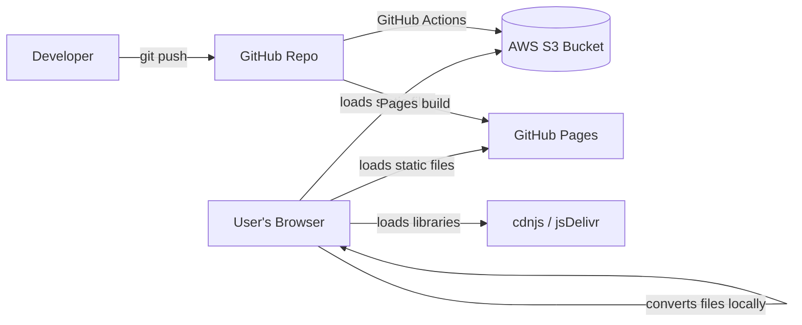

<div align="center">

# 🔄 convertX

### The all-in-one file converter that runs entirely in your browser

**No uploads · No sign-up · No server · 100% private**


[Live Demo (S3)](#-live-demo) · [Features](#-features) · [Architecture](#-architecture) · [Deployment](#-deployment)

</div>

---

## 📖 About

**convertX** is a static web application that bundles the most common document and image conversions into a single, clean interface. Every conversion happens **client-side with JavaScript**, so files never leave the user's device. This also means the site can be hosted on pure static hosting (GitHub Pages and AWS S3) with zero backend cost.

## 🌐 Live Demo

| Host | URL |
|------|-----|
| AWS S3 | `http://convertx-prathusha-website.s3-website-us-east-1.amazonaws.com` |
| GitHub Pages | `https://prathyusha2906.github.io/convertX/` |

> Replace the placeholders with your real URLs after deploying.

## ✨ Features

| Tool | Description |
|------|-------------|
| 📄 **PDF → Word** | Extracts text from every page into an editable `.docx` |
| 📝 **Word → PDF** | Converts `.docx` text content into a PDF |
| 🖼️ **Images → PDF** | Combines multiple images into one PDF, one image per page |
| 🎞️ **PDF → Images** | Renders each PDF page as PNG or JPG |
| 📚 **Merge PDFs** | Joins multiple PDFs into a single file |
| 🔁 **Image Converter** | Converts between JPG, PNG and WebP |

Other highlights:
- Drag-and-drop file input
- Responsive layout with automatic light/dark mode
- Shareable deep links per tool (e.g. `/#merge`)
- Works offline-friendly after first load (libraries cached by the browser)

## 🛠️ Tech Stack

- **Frontend:** HTML5, CSS3, vanilla JavaScript
- **Libraries (via CDN):** [pdf.js](https://mozilla.github.io/pdf.js/), [pdf-lib](https://pdf-lib.js.org/), [jsPDF](https://github.com/parallax/jsPDF), [docx](https://docx.js.org/), [mammoth.js](https://github.com/mwilliamson/mammoth.js)
- **Hosting:** AWS S3 static website hosting, GitHub Pages
- **CI/CD (optional):** GitHub Actions

## 🏗️ Architecture



Because all processing is client-side, the hosting layer only serves one HTML file.

## 📁 Project Structure

```
convertX/
├── index.html                  # The entire app (UI + logic)
├── README.md                   # You are here
├── LICENSE                     # MIT license
└── .github/
    └── workflows/
        └── deploy.yml          # Optional: auto-deploy to S3 on every push
```

## 💻 Run Locally

No build step is needed.

```bash
git clone https://github.com/<your-username>/convertX.git
cd convertX

# Option 1: open index.html directly in your browser
# Option 2: serve it locally
python -m http.server 8000
# then visit http://localhost:8000
```

## 🚀 Deployment

### Part 1: Push to GitHub

1. **Create a repository** on GitHub named `convertX` (leave it empty, with no README or license).
2. **Initialize and push** from your project folder:

```bash
cd convertX
git init
git add .
git commit -m "feat: initial release of convertX"
git branch -M main
git remote add origin https://github.com/<your-username>/convertX.git
git push -u origin main
```

3. **(Optional) Enable GitHub Pages:** repository → **Settings → Pages** → Source: *Deploy from a branch* → Branch: `main`, folder `/ (root)` → **Save**. Your site goes live at `https://<your-username>.github.io/convertX/`.

---

### Part 2: Host on AWS S3

#### Option A: AWS Console

1. **Create the bucket**
   - Open **S3 → Create bucket**.
   - Bucket name: globally unique, e.g. `convertx-yourname`.
   - Choose a region (e.g. `ap-south-1`, Mumbai).
2. **Allow public access**
   - Under *Block Public Access settings*, **uncheck** "Block all public access" and acknowledge the warning.
   - Click **Create bucket**.
3. **Upload files**
   - Open the bucket → **Upload** → add `index.html` → **Upload**.
4. **Enable static website hosting**
   - Bucket → **Properties** → scroll to *Static website hosting* → **Edit** → **Enable**.
   - Hosting type: *Host a static website*.
   - Index document: `index.html` → **Save changes**.
5. **Add a public-read bucket policy**
   - Bucket → **Permissions → Bucket policy → Edit**, then paste (replace the bucket name):

```json
{
  "Version": "2012-10-17",
  "Statement": [
    {
      "Sid": "PublicReadGetObject",
      "Effect": "Allow",
      "Principal": "*",
      "Action": "s3:GetObject",
      "Resource": "arn:aws:s3:::convertx-yourname/*"
    }
  ]
}
```

6. **Open your site**
   - Bucket → **Properties → Static website hosting** → copy the **Bucket website endpoint** and open it in a browser.

#### Option B: AWS CLI

```bash
# 1. Configure credentials once
aws configure

# 2. Create the bucket (change name and region)
aws s3 mb s3://convertx-yourname --region ap-south-1

# 3. Allow public policies
aws s3api put-public-access-block --bucket convertx-yourname \
  --public-access-block-configuration \
  BlockPublicAcls=false,IgnorePublicAcls=false,BlockPublicPolicy=false,RestrictPublicBuckets=false

# 4. Enable static website hosting
aws s3 website s3://convertx-yourname/ --index-document index.html

# 5. Attach the public-read policy (save the JSON above as policy.json first)
aws s3api put-bucket-policy --bucket convertx-yourname --policy file://policy.json

# 6. Upload the site
aws s3 sync . s3://convertx-yourname --exclude ".git/*" --exclude ".github/*" --exclude "README.md"
```

Your site is now live at:
`http://convertx-yourname.s3-website.ap-south-1.amazonaws.com`

> **Note:** S3 website endpoints are **HTTP only**. For HTTPS and a custom domain, put **CloudFront** in front of the bucket (see below).

---

### Part 3 (Optional): HTTPS with CloudFront

1. **CloudFront → Create distribution**.
2. Origin domain: your S3 **website endpoint** (not the bucket REST endpoint).
3. Viewer protocol policy: *Redirect HTTP to HTTPS*.
4. Default root object: `index.html`.
5. After deployment, use the `https://<id>.cloudfront.net` URL.
6. For a custom domain, request a certificate in **AWS Certificate Manager (us-east-1)** and add the domain as an alternate name.

---

### Part 4 (Optional): Auto-deploy with GitHub Actions

Every `git push` to `main` can sync the site to S3 automatically.

1. In your repo: **Settings → Secrets and variables → Actions → New repository secret**. Add:
   - `AWS_ACCESS_KEY_ID`
   - `AWS_SECRET_ACCESS_KEY`
   - `AWS_REGION` (e.g. `ap-south-1`)
   - `S3_BUCKET` (e.g. `convertx-yourname`)
2. Create `.github/workflows/deploy.yml`:

```yaml
name: Deploy convertX to S3

on:
  push:
    branches: [main]

jobs:
  deploy:
    runs-on: ubuntu-latest
    steps:
      - uses: actions/checkout@v4

      - uses: aws-actions/configure-aws-credentials@v4
        with:
          aws-access-key-id: ${{ secrets.AWS_ACCESS_KEY_ID }}
          aws-secret-access-key: ${{ secrets.AWS_SECRET_ACCESS_KEY }}
          aws-region: ${{ secrets.AWS_REGION }}

      - name: Sync to S3
        run: |
          aws s3 sync . s3://${{ secrets.S3_BUCKET }} \
            --exclude ".git/*" --exclude ".github/*" --exclude "README.md" --delete
```

> 🔒 **Security tip:** create a dedicated IAM user whose policy allows only `s3:PutObject`, `s3:DeleteObject` and `s3:ListBucket` on this one bucket. Never commit access keys to the repository.

## ⚠️ Limitations

- **PDF → Word** extracts text only; complex layouts, tables and images are not preserved, and scanned PDFs need OCR.
- **Word → PDF** converts text only, without embedded images or advanced formatting.
- Very large files depend on the visitor's device memory.
- High-fidelity conversion would require a server-side engine (e.g. LibreOffice), which is outside the scope of a static site.

## 🗺️ Roadmap

- [ ] Split, rotate and compress PDFs
- [ ] OCR for scanned PDFs
- [ ] Excel / CSV conversions
- [ ] Separate SEO pages per tool
- [ ] PWA support for offline use

## 🤝 Contributing

Contributions are welcome.

1. Fork the repository
2. Create a branch: `git checkout -b feature/new-tool`
3. Commit: `git commit -m "feat: add new tool"`
4. Push: `git push origin feature/new-tool`
5. Open a Pull Request

## 📄 License

Distributed under the **MIT License**. See `LICENSE` for details.

## 👩‍💻 Author

**Prathusha Tangirala**
B.Tech, Artificial Intelligence & Machine Learning, Bapatla Engineering College

[GitHub](https://github.com/<your-username>) · [LinkedIn](https://www.linkedin.com/in/<your-profile>)

---

<div align="center">

⭐ If you found this project useful, consider giving it a star!

</div>
